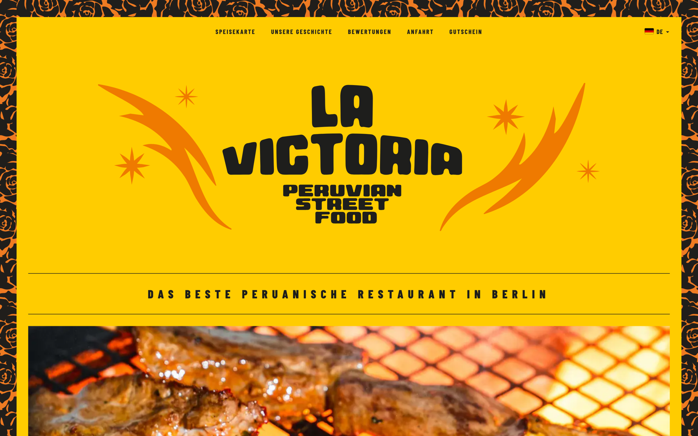

# La Victoria Berlin

Website of **La Victoria**, a Peruvian street food restaurant at Markthalle Pfefferberg, Prenzlauer Berg — Schönhauser Allee 176, 10119 Berlin.

Live: **[www.lavictoria.berlin](https://www.lavictoria.berlin)**



## What it is

A static, multi-page marketing site in five languages (DE · EN · ES · FR · IT). Plain HTML, one shared stylesheet and a few small vanilla-JS files — **no build step, no bundler, no framework, no dependencies to install**.

- **Zero third-party scripts.** No analytics, no CDN, no embeds, no cookies. Fonts, reviewer avatars and every asset are self-hosted.
- **Five complete translations.** There is no runtime i18n; each language is its own fully translated copy under `/de/`, `/en/`, `/es/`, `/fr/`, `/it/`. The root page picks one from the visitor's browser language and redirects.
- **Clean URLs.** `/de/`, `/de/menu`, `/impressum` — the `.html` files stay on disk and the host resolves them extensionless.
- **Built for speed.** The stylesheet is inlined into every page to remove the render-blocking request; the Google-reviews marquee is a pure-CSS animation built lazily on scroll.
- **SEO.** Per-language `canonical` + `hreflang`, JSON-LD (`Restaurant`, `Menu`, `BreadcrumbList`), per-language sitemaps and an `llms.txt` descriptor.

## Layout

```
index.html              # language detection → redirects to /de/, /en/, …
<de|en|es|fr|it>/       # one folder per language: index.html + menu.html + sitemap.xml
impressum.html          # legal pages (German only)
datenschutz.html
styles/site.css         # the single stylesheet (inlined into every page)
scripts/nav.js          # shared nav, language dropdown, mobile menu, reviews marquee
scripts/footer.*.js     # per-language footer
scripts/tools/          # dev-time utilities (not served)
assets/                 # fonts, images, svg, avatars, videos, favicons
data/reviews/           # source data for the reviews marquee
```

## Running it locally

No install, no build:

```bash
python3 -m http.server 8080
```

That serves `/de/` but not the extensionless `/de/menu`. For real clean-URL testing use a server that resolves extensionless paths, e.g. `npx serve`.

After editing `styles/site.css`, re-inline it into every page:

```bash
python3 scripts/tools/inline-css.py
```

## Deployment

Hosted on **Cloudflare Pages**; `git push` to `main` deploys. `_headers` sets the cache policy (long TTL for `/assets/*`, `/styles/*` and `/scripts/*`, 7 days for images), `_redirects` handles the rest. The apex domain redirects to `www`.

`scripts/nav.js` and the footer scripts are referenced with a `?v=N` query string — bump it when you change them so returning visitors get the new file.
